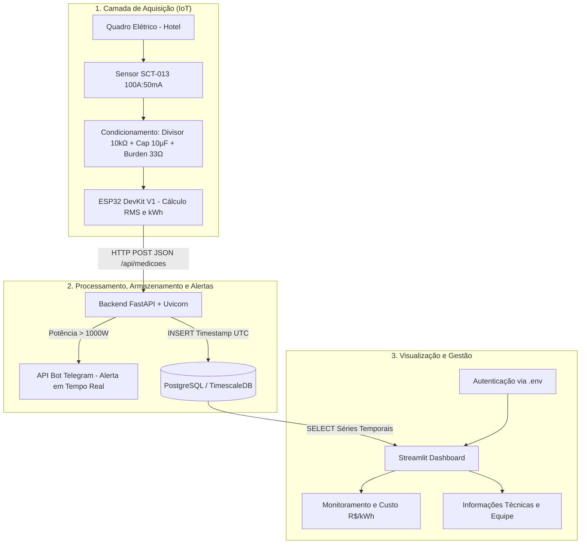

# ⚡ Sistema de Monitoramento de Energia em Tempo Real (IoT, Séries Temporais e Analytics)

> **Projeto Integrador II (PI-II) – Universidade Virtual do Estado de São Paulo (UNIVESP)**  
> **Polo:** Leme - SP | **Ano:** 2026

Ecossistema completo de telemetria e monitoramento energético desenvolvido para gestão predial e comercial (aplicado ao painel de distribuição elétrica de um hotel). O sistema realiza a coleta não invasiva de corrente elétrica na ponta via **ESP32**, processa e armazena os dados em séries temporais utilizando **FastAPI** e **PostgreSQL/TimescaleDB**, dispara alertas críticos automáticos pelo **Telegram** e disponibiliza um painel gerencial autenticado em **Streamlit**.

---

## 🏗️ Arquitetura do Sistema



---

## 🚀 Funcionalidades Principais

* **Aquisição Não Invasiva (Hardware IoT):** Leitura de corrente alternada utilizando transformador de corrente **SCT-013 (100A:50mA)** e circuito de condicionamento analógico (divisor de tensão 1,65V, filtro capacitivo e resistor *burden*) conectado ao **ESP32**.
* **API Assíncrona de Ingestão:** Servidor **FastAPI** (`POST /api/medicoes`) responsável por receber os pacotes JSON do microcontrolador e registrar o carimbo de tempo unificado no servidor.
* **Banco de Dados de Séries Temporais:** Persistência estruturada em **PostgreSQL / TimescaleDB** (`tabela: metricas_eletricas`), otimizada para consultas históricas de alta frequência.
* **Alertas Automatizados via Telegram:** Monitoramento contínuo que dispara notificações instantâneas para a equipe de manutenção sempre que a potência ativa ultrapassa o limite estipulado (ex: `1000 W`), com trava anti-spam de 60 segundos.
* **Dashboard Gerencial Autenticado:** Interface web desenvolvida em **Streamlit** contendo:
  * **Tela de Login:** Controle de acesso via `st.session_state` com credenciais protegidas em variáveis de ambiente (`.env`).
  * **Monitoramento em Tempo Real:** Indicadores de Corrente RMS (A), Potência Ativa (W), Consumo Acumulado (kWh), cálculo dinâmico de custo financeiro (R\$/kWh), gráficos temporais e histórico tabular.
  * **Tela de Informações:** Documentação da arquitetura de hardware/software, boas práticas de segurança elétrica e identificação da equipe.

---

## 🛠️ Tecnologias Utilizadas

* **Hardware & Firmware:** ESP32 DevKit V1, Sensor SCT-013-000, C++ / Arduino IDE
* **Backend & API:** Python 3, FastAPI, Uvicorn, Pydantic, Requests
* **Banco de Dados:** PostgreSQL, TimescaleDB, `psycopg2`
* **Frontend & Visualização:** Streamlit, Pandas
* **Integrações & Segurança:** Telegram Bot API, `python-dotenv`

---

## 📂 Estrutura do Repositório

```text
PII/
├── backend/
│   └── app.py                 # API FastAPI (ingestão de dados e alertas Telegram)
├── frontend/
│   └── dashboard.py           # Interface Streamlit (login, gráficos e informações)
├── firmware/
│   └── esp32_monitor.ino      # Código embarcado do ESP32 (aquisição e envio JSON)
├── .env.example               # Modelo das variáveis de ambiente necessárias
├── .gitignore                 # Arquivos ignorados pelo Git (.env, venv, __pycache__)
├── requirements.txt           # Dependências Python do projeto
└── README.md                  # Documentação do projeto
```

---

## ⚙️ Como Executar o Projeto Localmente

### 1. Clonar o repositório e criar o ambiente virtual
```bash
git clone https://github.com
cd SEU-REPOSITORIO
python -m venv venv

# Ativar no Windows:
venv\Scripts\activate
# Ativar no Linux/Mac:
source venv/bin/activate
```

### 2. Instalar as dependências
```bash
pip install -r requirements.txt
```

### 3. Configurar as variáveis de ambiente (`.env`)
Crie um arquivo chamado `.env` na raiz do projeto (baseado no `.env.example`) e preencha com suas credenciais:

```env
# Banco de Dados PostgreSQL / TimescaleDB
DB_HOST=localhost
DB_PORT=5432
DB_NAME=seu_banco
DB_USER=seu_usuario
DB_PASS=sua_senha

# Alertas Telegram
Telegram_Bot_Token=seu_token_do_botfather
TELEGRAM_CHAT_ID=seu_chat_id

# Acesso ao Painel Streamlit
APP_USER=admin
APP_PASS=univesp2026
```

### 4. Executar o Backend (API FastAPI)
Em um terminal, inicie o servidor da API na porta `8000`:
```bash
uvicorn backend.app:app --host 0.0.0.0 --port 8000 --reload
```

### 5. Executar o Frontend (Dashboard Streamlit)
Em um segundo terminal, inicie a interface web:
```bash
streamlit run frontend/dashboard.py
```

---

## 🎓 Equipe – Projeto Integrador II (UNIVESP)

* **Mateus Silva**
* **André Oliveira**

**Polo:** Leme - SP  
**Instituição:** Universidade Virtual do Estado de São Paulo (UNIVESP)
